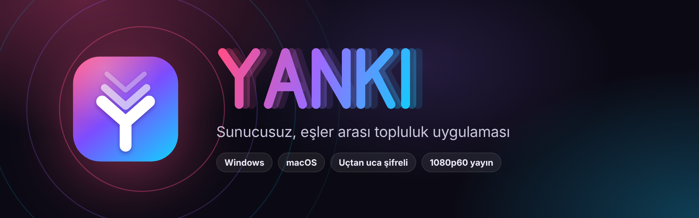
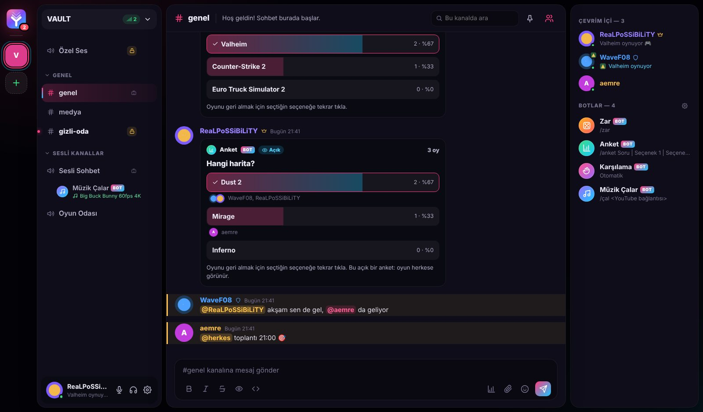
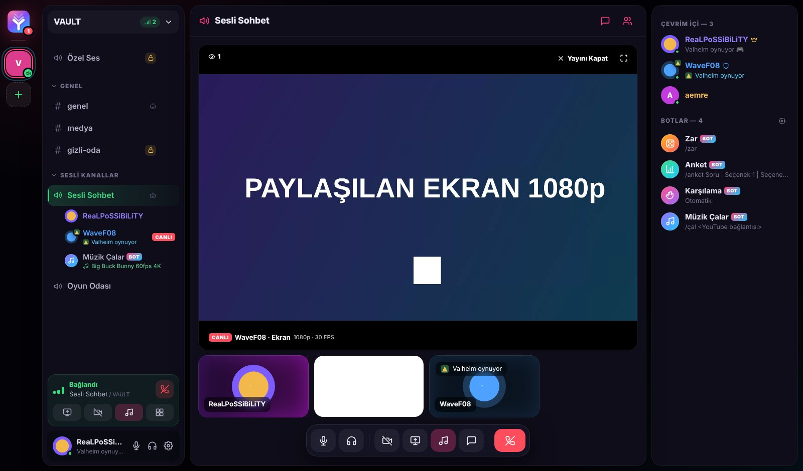
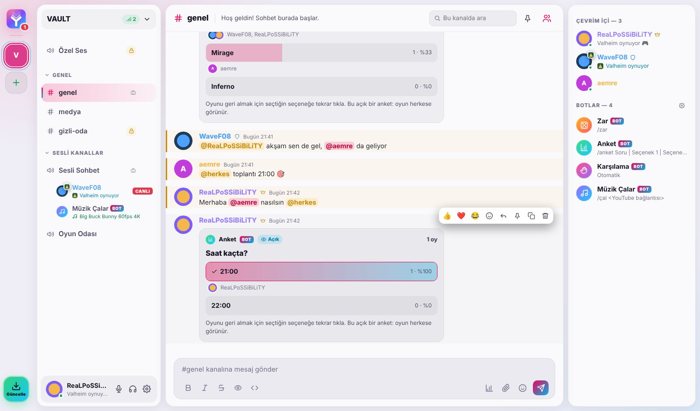
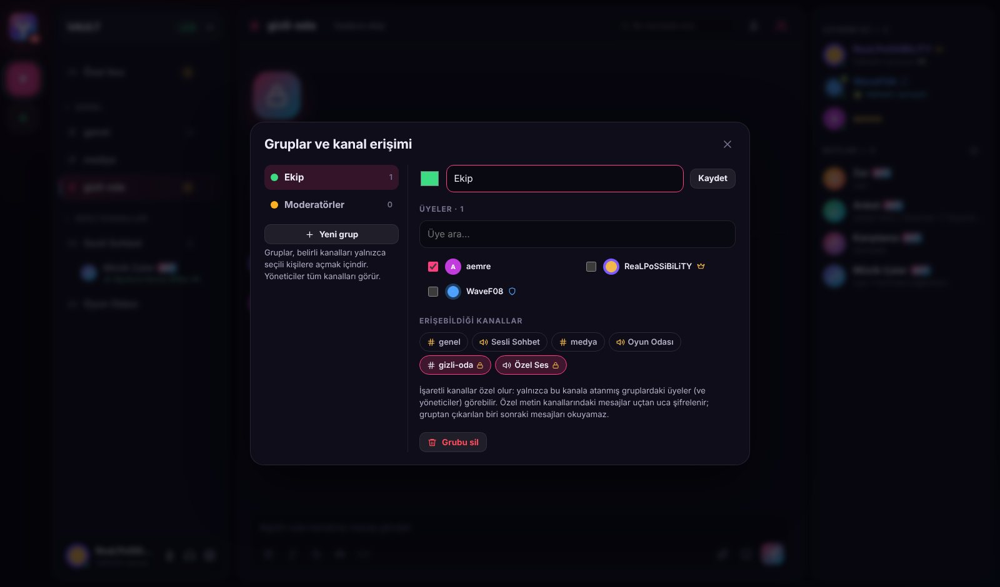
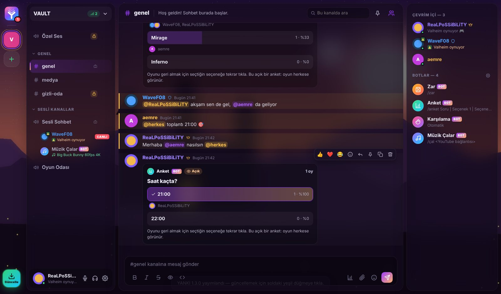

<p align="center"></p>

<p align="center">
  <a href="https://github.com/ReaLPoSSiBiLiTY/YANKI/releases/latest"></a>
  
  
</p>

<p align="center"><b>Merkezi sunucusuz, eşler arası (P2P) topluluk ve haberleşme uygulaması.</b><br>
Topluluğun yalnızca üyelerinin bilgisayarlarında yaşar; herkes birbirine doğrudan, şifreli bağlantılarla bağlanır.</p>

<p align="center"><a href="https://github.com/ReaLPoSSiBiLiTY/YANKI/releases/latest"><b>⬇ Son sürümü indir</b></a></p>

<p align="center"></p>

## Neler var?

| | |
|---|---|
| 💬 **Sunucular ve kanallar** | Metin ve ses kanalları, kategoriler, yanıtlar, tepkiler, sabitleme, resim/GIF, YouTube önizlemesi |
| 🎙️ **Ses, görüntü, yayın** | Sesli/görüntülü sohbet ve 1080p60 ekran paylaşımı; yayın yalnızca "Yayını İzle" diyenlere gider |
| 🔒 **Gruplar ve özel kanallar** | Kanalları belirli gruplara aç; özel metin kanalları uçtan uca şifrelenir |
| 📣 **@bahsetme** | `@` yaz, kişiyi seç; `@herkes` ile herkese bildirim |
| 👥 **Arkadaşlar ve özel mesajlar** | Arkadaşlık istekleri, engelleme, açık ekranı bozmayan mini mesaj penceresi |
| 🤖 **Botlar** | Zar, açık/gizli Anket, Karşılama ve herkesin aynı anda dinlediği Müzik Çalar |
| 🎮 **Etkinlik** | Oynadığın oyun ve Spotify / Apple Music'te çalan şarkı profilinde görünür |
| 🎨 **Temalar** | Koyu ve açık mod; Futbol, FPS, RPG, Yarış ve daha fazla özgün tema, kendi resminden palet |
| ⬆️ **Otomatik güncelleme** | Yeni sürüm çıkınca "Güncelle" düğmesi; tek tıkla kurulur |

<table>
  <tr>
    <td></td>
    <td></td>
  </tr>
  <tr>
    <td align="center"><sub>Yayını İzle · izleyici sayısı · Yayını Kapat</sub></td>
    <td align="center"><sub>Açık mod</sub></td>
  </tr>
  <tr>
    <td></td>
    <td></td>
  </tr>
  <tr>
    <td align="center"><sub>Gruplar ve kanal erişimi</sub></td>
    <td align="center"><sub>Kale Alacakaranlığı (RPG) teması</sub></td>
  </tr>
</table>

## v1.3'te yenilikler

- **Yalnızca davetle kullanım:** YANKI'yı indiren biri, bir sunucu yöneticisinden davet kodu almadan uygulamayı kullanamaz. Davetler süreli ve sınırlı kullanımlıdır, iptal edilebilir (Sunucu menüsü › Davet et). Eski kalıcı kodlar çalışmaz; yeni sunucuyu yalnızca mevcut yöneticiler açabilir.
- **Grup simgeleri:** Her gruba seçilebilir bir simge; üye listesinde adın yanında görünür.
- **Çift tıkla mesaj at:** Üye listesinde birine çift tıklayınca mini özel mesaj penceresi açılır.
- **Arka planda çalışma:** Pencere kapatılınca YANKI görev çubuğundaki simgeye iner; tamamen kapatmak için simgeye sağ tıklayıp "Çıkış".

> **Kimliğini yedekle:** Yeni sunucuyu yalnızca yöneticiler açabildiği için kimlik dosyanı (`p2p/identity.json`) kaybetmemen önemlidir. Kaybolursa başka bir yöneticiden davet alarak geri dönebilirsin. Kurucu anahtarlarını `package.json` içindeki `yanki.founders` listesine eklersen o kimlikler davetsiz de sunucu açabilir.

## v1.2'de yenilikler

> **1.2.1 (güvenlik güncellemesi):** Bağlantı önizlemeleri artık yerel ağ adreslerini açmıyor, güncellemeler yalnızca resmi sürüm sayfasından indiriliyor, gelen veriler daha sıkı denetleniyor ve pencere küçültülünce arayüz çizimi duruyor.

- **Otomatik güncelleme:** Uygulama GitHub sürüm sayfasını takip eder. Yeni sürüm çıkınca sol altta yeşil **Güncelle** düğmesi belirir; tıklayınca indirilir, kurulur ve YANKI yeniden açılır.
  - Windows: kurulum dosyasıyla (.exe) kurulan sürümde tam otomatik. Kurulumsuz (.zip) sürümde indirme sayfası açılır.
  - macOS: YANKI **Uygulamalar** klasöründeyse tam otomatik.
- **Yenilikler ekranı:** Güncellemeden sonraki ilk açılışta bu sürümde neler değiştiği gösterilir (Ayarlar › Hakkında'dan da açılır).
- **@bahsetme:** `@` yazınca kanaldaki kişiler (önce çevrim içi olanlar) ve `@herkes` listelenir. Bahsedilen kişiye bildirim gider; kanal ve sunucu yanında sayaç görünür. Ad sonradan değişse de bahsetme doğru kişiyi gösterir.
- **Gruplar ve özel kanallar:** Yöneticiler grup oluşturur (Sunucu menüsü › Gruplar ve erişim) ve metin/ses kanallarını yalnızca seçili gruplara açar.
  - Özel kanallar kilit simgesiyle ayrılır; gruba dahil olmayanlar kanalı göremez, sesine bağlanamaz.
  - Özel metin kanallarının mesajları kanal anahtarıyla uçtan uca şifrelenir. Gruptan çıkarılan biri için anahtar yenilenir; sonraki mesajları okuyamaz.
- **Yayını İzle:** Ekran yayınları artık kendiliğinden açılmaz. "Yayını İzle" ile başlar, üzerinde izleyici sayısı görünür, "Yayını Kapat" ile çıkılır. Yayıncının bilgisayarı yalnızca izleyenler için kodlama yapar ve mümkünse donanım hızlandırmalı H.264 kullanır; oyundaki takılmalar azalır.
- **Tam ekran düzeltmesi:** Tam ekran izlenen yayın artık kendiliğinden küçük görünüme dönmüyor.
- **Daha sağlam bağlantı:** "Bağlanıyor…"da takılan kişiler daha hızlı onarılıyor; gerekirse kişinin kutusundaki **Yeniden bağlan** düğmesiyle tek kişiyle bağlantı sıfırlanabiliyor. Aynı kişiyle ikinci bir ağ bağlantısı açıldığında eskisinin kopması düzeltildi.
- **Açık ve gizli anket:** Anket simgesinden (ya da `/anket` / `/açıkanket`) oluşturulur; anketi açan kişi kimin neye oy verdiğinin görünüp görünmeyeceğini seçer.
- **Mini özel mesaj penceresi:** Bir sunucudayken açılan özel mesajlar sağ altta küçük bir pencerede açılır; bulunduğun ekran değişmez. Tam görünüme tek tıkla geçilir.
- **Koyu / Açık / Sistem modu** ve yeni temalar: Gece Maçı (Futbol), Taktik HUD (FPS), Kale Alacakaranlığı (RPG), Gece Pisti (Yarış). Tüm temaların açık mod sürümü var. Görseller YANKI için kodla üretilmiştir; hiçbir oyun, takım ya da markaya ait içerik kullanılmaz.
- **Daha az kaynak tüketimi:**
  - Sohbet geçmişi her yeni mesajda baştan hesaplanmıyor, artımlı işleniyor.
  - Windows'ta oyun algılama tek ve hafif bir sorguyla yapılıyor.
  - Pencere arka plandayken arayüz çizilmiyor.
  - İsteğe bağlı **Performans modu** cam bulanıklığını ve animasyonları kapatıyor.

## Kurulum ve çalıştırma

Gereksinim: [Node.js 22+](https://nodejs.org)

```bash
npm install
npm start
npm run start:2   # aynı bilgisayarda ikinci bir kullanıcıyla denemek için
```

## Kurulum dosyası üretme

```bash
npm run dist:win   # Windows'ta → dist/YANKI-1.3.0-win-x64.exe ve kurulumsuz .zip
npm run dist:mac   # macOS'ta  → dist/YANKI-1.3.0-mac-arm64.dmg / mac-x64.dmg (+ güncelleme için .zip)
```

İki platformu birden derlemek için `v1.2.0` gibi bir etiket gönder. `.github/workflows/build.yml` iki platformu derler, sürüm notlarını `renderer/changelog.js`'ten üretir ve Releases sayfasında yayınlar. Uygulamalar güncellemeyi bu sayfadan alır.

### Yeni sürüm çıkarma

1. `package.json` içindeki `version` değerini yükselt. Yeni özellikler için ara sürüm (ör. `1.3.0`), güvenlik ve hata düzeltmeleri için alt sürüm (ör. `1.2.2`).
2. `renderer/changelog.js` dosyasının en üstüne yeni sürümün maddelerini ekle. Hem uygulamadaki Yenilikler ekranı hem GitHub sürüm sayfası buradan üretilir.
3. Değişiklikleri gönder ve `v1.3.0` etiketini oluşturup gönder.

> Otomatik güncellemenin çalışması için depo **herkese açık** olmalıdır (uygulamalar sürüm bilgisini GitHub'dan girişsiz okur).

## Nasıl çalışır

- **Kimlik:** Bilgisayarda üretilen bir ed25519 anahtarıdır; hesap, e-posta ya da şifre yoktur. Açık anahtar aynı zamanda arkadaş kodudur (`yanki://arkadas/…`).
- **Keşif:** Her sunucu, Hyperswarm DHT'de kendine ait bir konuya katılır. Ayrıca her kullanıcıya açık anahtarıyla doğrudan ulaşılabilir; arkadaşlık istekleri böyle iletilir.
- **Veri:** Sunucudaki her işlem, yazarınca imzalanan değişmez bir kayıttır. Durum bu kayıtlardan aynı kurallarla hesaplandığı için herkes aynı sonucu görür ve yetkisiz işlemler her eşte yok sayılır. Eski profil kayıtları (örneğin büyük GIF'ler) budanır, böylece günlük şişmez.
- **Özel alan:** Her kullanıcı çifti için yalnızca o ikisi arasında eşitlenen ayrı bir kayıt deposu vardır.
- **Botlar:** Sürekli çalışan bir bot sunucusu yoktur; botların davranışı herkesin uygulamasında aynı kurallarla hesaplanır.
  - Zar sonucu mesajın kimliğinden türetilir.
  - Müzik kuyruğunun zamanlaması kayıtlardan ve şarkı sürelerinden hesaplanır; her dinleyici YouTube'dan aynı saniyeden çalar.
- **Özel kanallar:** Her üye sunucuda bir X25519 açık anahtarı yayımlar. Özel metin kanalının anahtarı, kanala erişebilen her üye için ayrı ayrı (ECDH + HKDF + AES-256-GCM) mühürlenerek dağıtılır; mesajlar bu anahtarla şifrelenir. Erişimi kalkan biri olunca yönetici yeni bir anahtar kuşağı oluşturur.
- **Ses ve görüntü:** WebRTC mesh topolojisi kullanılır.
  - Her katılış yeni bir oturum kimliği alır.
  - Erken gelen ICE adayları tamponlanır.
  - Takılan bağlantılarda 6 saniyede ICE yeniden başlatılır, olmazsa 15 saniyede bağlantı sıfırdan kurulur.
  - Ekran yayını yalnızca izlemek isteyenlere eklenir.

### Bilinen sınırlar

- Uygulamanın indirilmesi engellenemez (sürüm sayfası herkese açıktır); ancak davetsiz indirilen uygulama hiçbir sunucuya giremez ve kimseye mesaj atamaz. Kaynak kodunu değiştirip kendi sürümünü derleyen biri yalnızca kendi kurduğu, sizinkinden bağımsız bir sunucu açabilir.
- Bir sunucunun ya da özel sohbetin yeni verisi, karşı tarafın uygulaması açıkken eşitlenir.
- Mesh topolojide her izleyiciye ayrı akış gider. 1080p60 izleyici başına yaklaşık 9 Mbps yükleme ister.
- Gizli anketlerde oylar arayüzde gösterilmez, ancak oylar imzalı kayıtlar olduğu için uygulamayı değiştiren biri kimin oy verdiğini görebilir.
- Özel kanallarda mesaj metni ve ekler şifrelenir; tepkiler, anket oyları ve mesaj zamanları gibi üst bilgiler şifrelenmez (sunucu üyeleri arasında kalır).
- Yankısız sistem sesi Windows'ta, Chromium'un `restrictOwnAudio` özelliğine dayanır. Sistem bunu desteklemezse ekran sessiz paylaşılır; istersen Ayarlar › Ekran Paylaşımı'ndan yine de sesli paylaşabilirsin. macOS'ta sistem sesi paylaşımı yoktur.
- Müzik Çalar YouTube gömme oynatıcısını kullanır. Sahibinin gömmeye kapattığı videolar çalmaz.
- Zar sonucu deterministiktir. Kendi uygulamasını değiştiren biri, istediği sonucu verecek bir mesaj kimliği arayabilir; bu sistem arkadaş ortamı için tasarlandı.
- Uygulama imzasız olduğu için ilk açılışta Windows ve macOS uyarı verebilir.

## Proje yapısı

```
main.js              Ana süreç: pencere, IPC, ekran paylaşımı, etkinlik, YouTube bilgisi, veri taşıma
preload.js           Arayüze güvenli API köprüsü
src/p2p/node.js      P2P düğümü: keşif, eşitleme, arkadaşlık/özel mesaj, sinyal aktarma, etkinlik
src/p2p/state.js     Kayıtlardan durum: sunucu, botlar (zar/anket/müzik), özel alan
src/activity.js      Oyun ve Spotify/Apple Music algılama
src/updater.js       GitHub Releases üzerinden otomatik güncelleme
scripts/release-notes.js  Sürüm sayfası metni (changelog.js'ten)
renderer/
  changelog.js       Sürüm notları (Yenilikler ekranı ve GitHub sürüm sayfası)
  extras.js          @bahsetme, anket oluşturucu, mini özel mesaj, gruplar, güncelleme ekranları
  core.js            Ortak durum, avatarlar, modallar, resim/GIF yükleme
  app.js             Kanallar, mesajlar, sahne, ayarlar
  social.js          Arkadaşlar ve özel mesajlar
  bots.js            Bot kartları, komutlar, Müzik Çalar
  rtc.js             WebRTC ses/görüntü/ekran
  themes.js          Temalar ve resimden palet çıkarma
  themes/            Tema resimleri (özgün, telifsiz)
  assets/            Logo ve simge
test/                Çekirdek ve birim testleri (npm test)
docs/                README görselleri
```

Veriler şu klasörlerde tutulur:
- Windows: `%APPDATA%\YANKI`
- macOS: `~/Library/Application Support/YANKI`

`p2p/identity.json` gizli anahtarındır; yedeklersen kimliğini başka bilgisayara taşıyabilirsin.

## Lisans ve kullanım

YANKI, [MIT lisansıyla](LICENSE) ücretsiz ve "olduğu gibi" sunulur; hiçbir garanti verilmez ve geliştiriciler kullanımdan doğan zararlardan sorumlu tutulamaz.

YANKI'nın merkezi bir sunucusu yoktur; mesajlar geliştiricinin değil, yalnızca kullanıcıların bilgisayarları arasında dolaşır. Paylaşılan her içerikten (mesaj, resim, bağlantı, yayın) onu paylaşan kişi sorumludur. Yasa dışı, başkalarının haklarını ihlal eden ya da telifli içerik paylaşmayın. Sunucu sahipleri ve yöneticiler, kendi sunucularındaki uygunsuz içeriği kaldırmalı ve paylaşanları uzaklaştırmalıdır.
